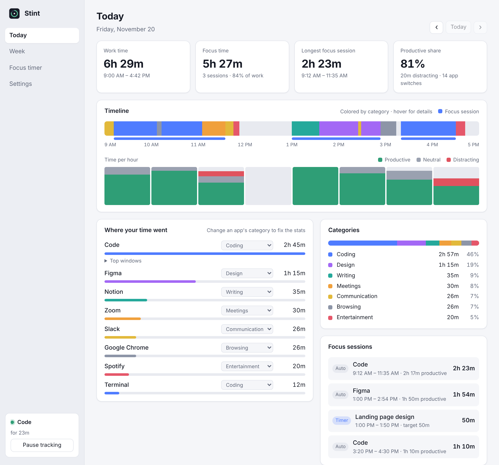

# Stint

**A lightweight, private time and focus tracker for macOS and Windows (Linux too).**

Stint runs quietly in your menu bar or system tray and answers:

- **How long did I work today?** Active time, from your first to your last activity.
- **How long did my focus sessions last?** Detected automatically, or timed yourself with the focus timer.
- **Where did my time go?** Time per app and per category, an hour-by-hour breakdown, and a timeline of your day.
- **How was my week?** Daily totals, focus time, and productive share.

Everything stays on your computer. Stint has no account, no cloud, no telemetry, and makes no network requests.



## Features

| | |
|---|---|
| ⏱ **Automatic tracking** | Samples the foreground app every 5 seconds. Away time (no keyboard or mouse input) is excluded. |
| 🎯 **Focus sessions** | Auto-detected stretches of productive work (default: 25+ min, with interruptions under 5 min tolerated), plus a manual focus timer. |
| 🗂 **Categories** | Apps are categorized automatically (Coding, Design, Writing, Meetings, Communication, Browsing, Entertainment…). Fix any app with one click. |
| 📊 **Day & week views** | Timeline, hourly chart, top apps, category split, context-switch count. |
| 🔒 **Private by default** | Only app names are recorded. Window titles are opt-in. Excluded-apps list, pause button, auto-delete, export, and one-click erase. |
| 🪶 **Lightweight** | Built with Tauri and Rust on the OS webview (no bundled Chromium): ~3 MB installer, ~7 MB app, about 2% of one CPU core while tracking. |

## Install

Download the latest installer from the **Releases** page:

- **macOS:** `Stint_x.y.z_universal.dmg` (Apple Silicon and Intel)
- **Windows:** `Stint_x.y.z_x64-setup.exe` (or the `.msi`)
- **Linux:** `.AppImage` or `.deb`

> Unsigned builds: until releases are code-signed, macOS will say the app "can't be opened". Right-click → **Open** the first time. On Windows, SmartScreen may require **More info → Run anyway**.

Closing the window keeps Stint tracking in the tray / menu bar. Use **Quit Stint** from the tray menu to stop it.

### Platform notes

- **macOS:** app names need no special permission. If you turn on **Record window titles**, macOS asks for **Screen Recording** permission, because that's how macOS gates reading other apps' window titles. Stint never captures screen contents.
- **Windows:** no permissions needed.
- **Linux:** X11 sessions are supported. Wayland compositors generally don't let apps see the focused window, so tracking may not work there.

## How it measures

1. Every 5 s, Stint asks the OS which app is in front and how long since the last keyboard or mouse input.
2. If you've been idle longer than the **Away after** threshold (default 5 min), the current span is closed at the moment input stopped. Away time is never counted.
3. Consecutive samples of the same app are merged into one span and written to a local SQLite database.
4. If the computer sleeps, the gap is detected and not counted.
5. **Work time** is the sum of all spans. **Focus sessions** are runs of *productive*-category spans where no gap or non-productive interruption exceeds the allowed interruption, and that last at least the minimum session length.

Productivity per category is fixed: Coding, Design, Writing, Research, and Meetings are *productive*. Communication, Browsing, Utilities, and Other are *neutral*. Entertainment and Social Media are *distracting*. If you do real work in a browser, reassign it to *Research*.

## Build from source

Prerequisites: [Rust](https://rustup.rs) (stable), Node.js 18+, and the [Tauri prerequisites](https://tauri.app/start/prerequisites/) for your OS (Xcode Command Line Tools on macOS, WebView2 + MSVC Build Tools on Windows).

```bash
npm install
npm run dev      # run in development mode
npm run build    # produce installers in src-tauri/target/release/bundle/
npm test         # run the Rust unit tests
```

To change the app icon, replace `src-tauri/icons/app-icon.png` (1024×1024) and run `npm run icons`.

### Releasing

Push a tag such as `v0.1.0`. GitHub Actions (`.github/workflows/release.yml`) builds macOS (universal), Windows, and Linux installers and attaches them to a **draft** release. See the comments in that file for code-signing secrets.

## Project layout

```
src/                 UI: plain HTML/CSS/JS, no framework, no third-party JS
src-tauri/
  src/tracker.rs     background sampler (foreground app + idle time)
  src/db.rs          SQLite schema and queries (parameterized only)
  src/summary.rs     totals, categories, focus-session detection
  src/categories.rs  category list + app-name heuristics
  src/commands.rs    IPC commands exposed to the UI (all inputs validated)
  src/export.rs      CSV / JSON export
  capabilities/      Tauri permissions: the UI may call only Stint's own commands
  tauri.conf.json    window, strict CSP, bundling
```

Your data lives in a single SQLite file:

| OS | Location |
|---|---|
| macOS | `~/Library/Application Support/app.stint.desktop/stint.sqlite3` |
| Windows | `%APPDATA%\app.stint.desktop\stint.sqlite3` |
| Linux | `~/.local/share/app.stint.desktop/stint.sqlite3` |

## Security & privacy

See [SECURITY.md](SECURITY.md) for the threat model, the hardening measures, and how to report a vulnerability.

## License

[MIT](LICENSE)
